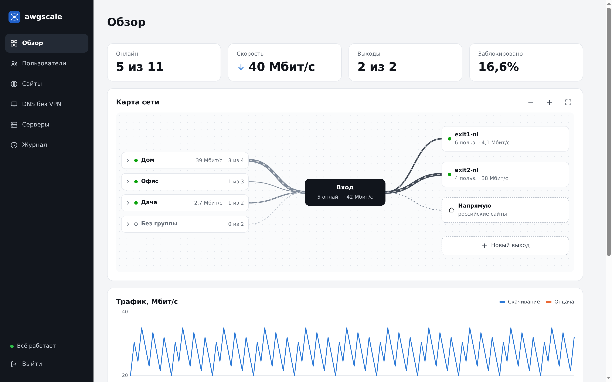
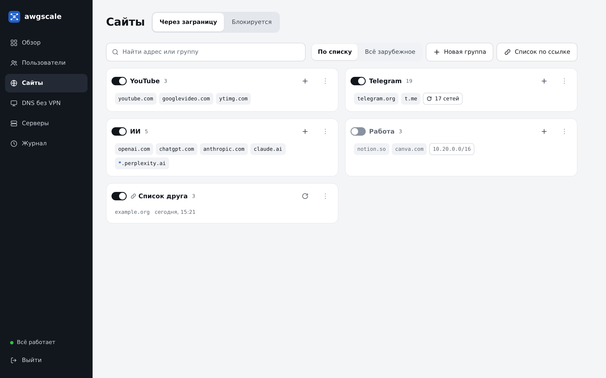
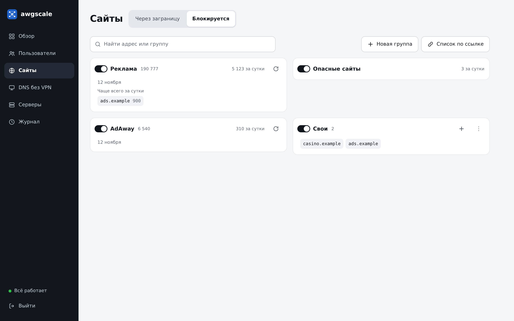
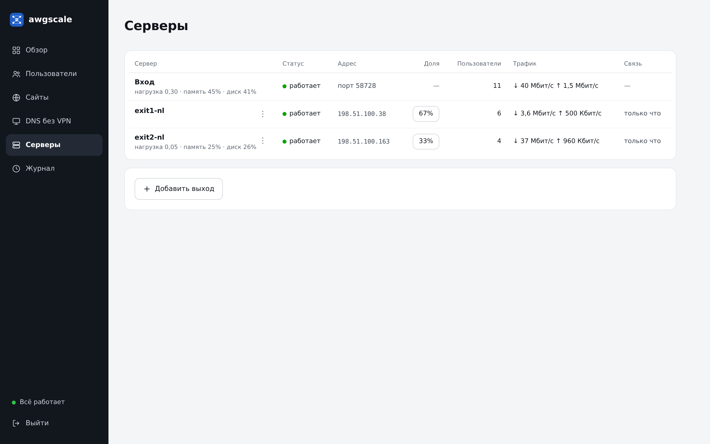

<p align="center">
  
</p>

<h1 align="center">awgscale</h1>

<p align="center">
  Your own router in the cloud: a self-hosted VPN on <a href="https://github.com/amnezia-vpn/amneziawg-linux-kernel-module">AmneziaWG</a>,<br>
  where you decide, site by site, what goes direct, what goes abroad and what is blocked.
</p>

<p align="center">
  <a href="README.ru.md">Русский</a> · <a href="docs/architecture.md">How it works</a> · <a href="#install">Install</a> · <a href="#known-limits">Known limits</a>
</p>


<sub>The admin panel against a stand-in server with made-up data (`tests/stub.py`). The interface is in Russian for now.</sub>

## What it is

The things people set up on a home router with split routing (some sites through a tunnel, the rest
direct, ads and threats filtered), done on a rented server instead, so they work on every device and
every network: phones on mobile data, laptops in a café, a TV at home.

* **An entry server** that your devices connect to with the stock AmneziaWG / AmneziaVPN apps. AmneziaWG
  is WireGuard with disguised handshakes and junk packets, so the tunnel is not trivially recognised and
  dropped by DPI.
* **Optional exit servers** abroad. The entry sends each connection either straight to the internet or
  through an exit, by the rules you set in the panel. Without exits it is a single-server VPN with
  filtering.
* **A web panel** for the rules, the users, the filtering and the servers, and an optional Telegram bot
  that alarms and reports.

It runs a real household and a few friends: one entry, two exits, a couple of dozen devices.

## What works today

**Routing**
* Groups of sites (domains, `*.wildcards`, networks) that go through an exit; everything else leaves
  the entry directly. Or the other way round: everything foreign through an exit, home-country sites
  direct.
* Lists by link (someone else's list, refreshed nightly, your own additions kept), and
  automatically maintained networks (Telegram's).
* Voice and video calls: UDP to foreign addresses can be sent through an exit as well, so WhatsApp,
  Telegram, Discord and Meet calls work in list mode.
* Several exits with shares of users, health probes every 15 s and failover: a user whose exit dies
  moves to a working one and comes back when it recovers. Pin a user or a group to one exit.
* **Fail-closed**: with every exit down, what should go abroad is dropped, never sent direct.

**Filtering** (AdGuard Home on the entry, for everyone in the tunnel)
* Ads and trackers, HaGeZi levels (Pro, Pro++, Ultimate), the threat list for everyone.
* A kids' mode per group with add-on lists (adult, gambling, filter bypass, social).
* Your own block groups and lists by link; the day's counts per list.

**Users**
* Users and groups, an expiry date, pause and resume, a QR code or a `vpn://` link to import.
* Invitations by link: a person opens it and gets their key, nothing to type.
* A journal of every change and of exits going up and down. Counts and bytes only: nobody's
  sites are recorded per user.

**Servers**
* Add an exit from the panel: give a fresh Ubuntu server's address and root password once, and the
  entry installs AmneziaWG on it, links it, firewalls it and starts sending users to it.
* DNS for devices without the VPN (DNS-over-HTTPS with personal codes and an SNI proxy), for a TV or
  a console that cannot run a VPN client.
* History in Prometheus, logs in Loki, Grafana dashboards. A daily dump of the settings.

| | |
|---|---|
|  |  |
| Groups of sites that go abroad; list mode or everything foreign | Filter lists, own block groups, counts per day |



## How routing works

```
 phone ─┐                 ┌────────────── entry (VPS) ──────────────┐
 laptop ├── AmneziaWG ──▶ │ AdGuard: resolves, filters, puts the    │ ── direct ──▶ internet
 TV    ─┘                 │ addresses of listed sites into ipsets   │
                          │ iptables marks a connection by ipset    │ ── AmneziaWG ──▶ exit 1 ──▶ internet
                          │ policy routing sends the mark to the    │ ── AmneziaWG ──▶ exit 2 ──▶ internet
                          │ user's exit; no exit up → blackhole     │
                          └─────────────────────────────────────────┘
```

1. A device asks the entry's DNS for a name. AdGuard answers and, if the name is in a list, adds its
   addresses to an ipset.
2. The connection that follows is marked by iptables because its destination is in that set (or in a
   listed network, or not in the home-country set in "everything foreign" mode).
3. Marked connections leave through the exit the user is pinned to; the mark is kept for the life of
   the connection, so switching exits never breaks open connections.
4. Unmarked connections leave the entry directly.

More in [docs/architecture.md](docs/architecture.md): the services, the boot sequence, and why things
are the way they are.

## Install

You need a Linux machine to deploy from (it builds the images; Docker and Node are used there), an
Ubuntu 24.04 VPS for the entry and a DNS name pointing at it. Exits are optional and can be added later.

```bash
# 1. On the entry: AmneziaWG with the installer by @bivlked (github.com/bivlked/amneziawg-installer)
bash install_amneziawg.sh --yes --no-color --disallow-ipv6 --route-all --protocol=3.1 \
    --subnet=172.16.17.1/24 --endpoint=vpn.example.net

# 2. On your machine
git clone https://github.com/qalby-tech/awgscale && cd awgscale
cp site.env.example site.env          # DOMAIN, the panel's allow-list, FEATURES
cp ssh_config.example ssh_config      # the entry's address and your SSH key
mkdir -p ~/.ssh/cm

# 3. The resolver and the host's packages, then the stack
ssh -F ssh_config entry 'bash -s' < entry/adguard-setup.sh
cascade/deploy.sh
stack/deploy.sh db users agent watch resolver panel traefik

# 4. The panel: https://<DOMAIN>, password:
ssh -F ssh_config entry cat /opt/vpn-stack/panel-data/.password
```

A new server starts as a single server (`SINGLE_SERVER=1`): no exits, everything leaves the entry,
filtering and users work. For exits, put `cascade` into `FEATURES`, then

```bash
stack/deploy.sh exits links
stack/switch-tunnel.sh on links       # the links to the exits are kept by a container
```

and add them in the panel (Servers → Add exit) or with `ops/exit.sh add <address> <name>`. The
first exit turns the single server into a cascade.

Optional parts are switched on in `site.env` and deployed by name:

| `FEATURES` | Services | What for |
|---|---|---|
| `cascade` | `exits` | adding and looking after exit servers from the panel |
| `bot` | `bot` | alarms, the daily report, users for the admin in Telegram |
| `smartdns` | `smartdns` | DNS-over-HTTPS + SNI proxy for devices without the VPN |
| `obs` | `prometheus loki alloy grafana` | traffic history and logs, Grafana at `/grafana` |
| `backup` | `db-backup` | a dump of the settings once a day |

`stack/deploy.sh` with no service names ships the images and files and changes nothing that runs; a
service is switched only when named, and each switch is checked before the next one starts.

## Validation

`tests/run.sh` runs everything without touching a server: the panel in a headless browser against a
stand-in, every service against recorded answers, the settings store in a throwaway Postgres, the
routing rules in a real kernel inside a throwaway network namespace (cascade and single-server, the
boot order, a restart), and every image started the way `compose.yml` starts it.

## Known limits

* **Russian-first.** "Direct" means Russian networks (the ipdeny RU zone); the interface, the journal
  and the bot speak Russian. Another home country is a planned setting.
* **IPv4 only.** Install with `--disallow-ipv6`; IPv6 is not routed.
* **One entry.** It is a single point of failure; moving users to a standby entry is a script
  (`ops/switch-entry.sh`, Cloudflare DNS), not automatic.
* **Stock clients.** Devices use the AmneziaWG / AmneziaVPN apps. Choosing the exit or the filter level
  on the device needs our own client, which is not written yet.
* **One admin.** One panel password; no roles, no user self-service.
* **A domain is routed by what the entry's DNS answered.** A device with its own DNS-over-HTTPS (some
  browsers) bypasses the lists; list the networks for those, or use "everything foreign".
* Deployment is from a Linux machine over SSH; images are built locally, nothing is published to a
  registry yet.
* **Experimental as a product.** The install path above is checked piece by piece in the tests and
  by running servers, not yet end to end on a clean VPS. Expect rough edges and report them.

## License

MIT, see [LICENSE](LICENSE). The panel's fonts (Inter, JetBrains Mono, Manrope) are under the SIL OFL 1.1
([panel/fonts/OFL.txt](panel/fonts/OFL.txt)). AmneziaWG, AdGuard Home, Traefik, Postgres and the Grafana stack keep
their own licenses; the filter lists (HaGeZi, AdAway) theirs.
