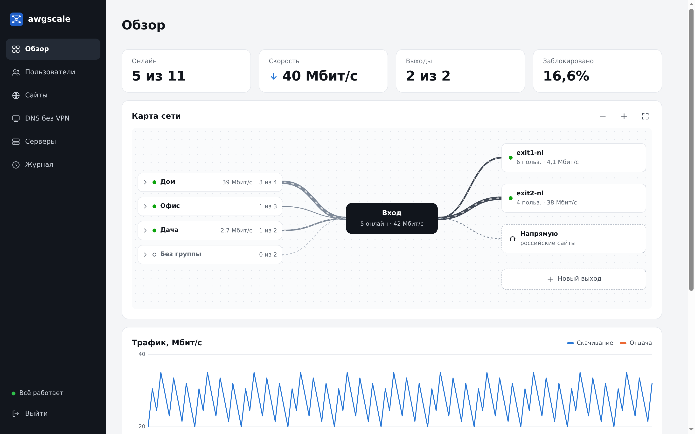
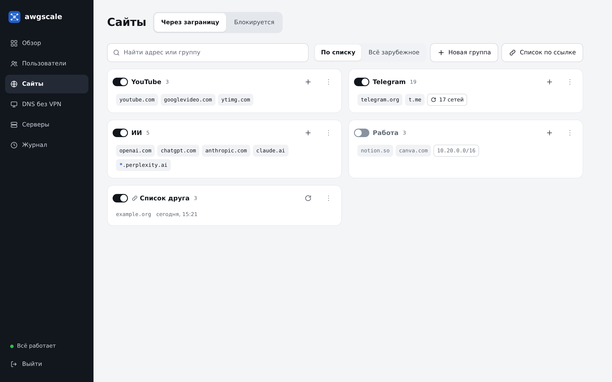
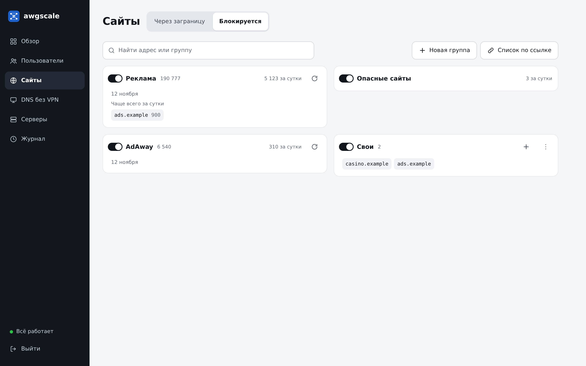
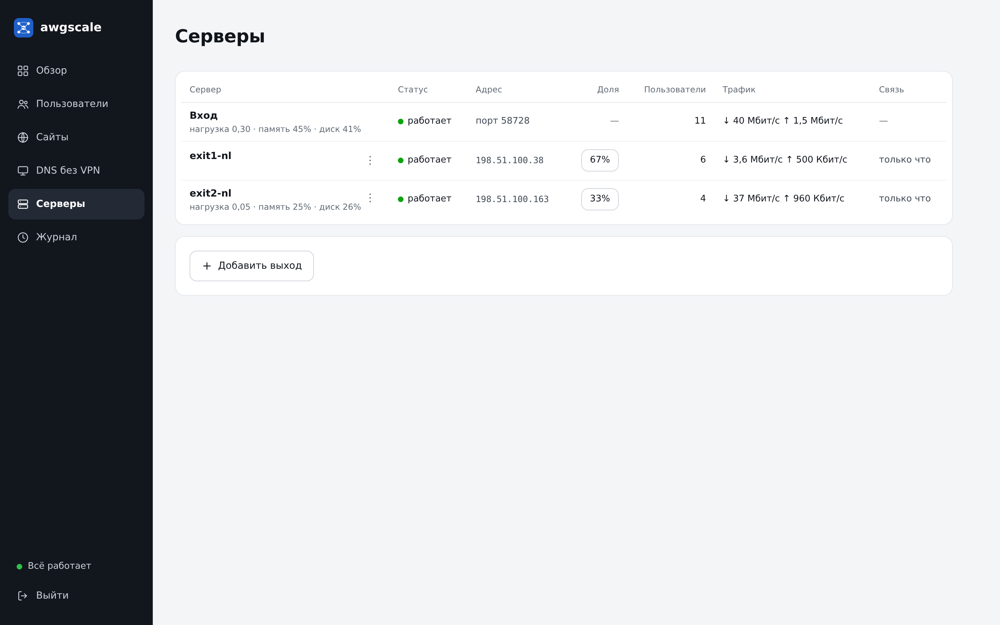

<p align="center">
  
</p>

<h1 align="center">awgscale</h1>

<p align="center">
  Свой роутер в облаке: VPN на <a href="https://github.com/amnezia-vpn/amneziawg-linux-kernel-module">AmneziaWG</a> на своём сервере,<br>
  где вы сами решаете, какой сайт идёт напрямую, какой через границу, а какой блокируется.
</p>

<p align="center">
  <a href="README.md">English</a> · <a href="docs/architecture.md">Как устроено</a> · <a href="#установка">Установка</a> · <a href="#известные-ограничения">Ограничения</a>
</p>


<sub>Панель на тестовой заглушке с выдуманными данными (`tests/stub.py`).</sub>

## Что это

То, что обычно настраивают на домашнем роутере (часть сайтов через туннель, остальное напрямую,
реклама и угрозы отфильтрованы), только на арендованном сервере. Поэтому работает на любом
устройстве и в любой сети: телефон на мобильном интернете, ноутбук в кафе, телевизор дома.

* **Входной сервер**: к нему подключаются устройства через обычные приложения AmneziaWG / AmneziaVPN.
  AmneziaWG — это WireGuard с замаскированным рукопожатием и мусорными пакетами: DPI не так просто его
  узнать и оборвать.
* **Выходы за границей** (по желанию). Вход отправляет каждое соединение либо прямо в интернет, либо
  через выход, по правилам из панели. Без выходов это VPN на одном сервере с фильтрацией.
* **Веб-панель** для правил, пользователей, фильтрации и серверов; по желанию — Telegram-бот с
  тревогами и отчётами.

Работает каждый день: один вход, два выхода, пара десятков устройств семьи и друзей.

## Что работает сейчас

**Маршрутизация**
* Группы сайтов (домены, `*.маски`, сети), которые идут через выход; остальное уходит со входа
  напрямую. Или наоборот: всё зарубежное через выход, российское напрямую. Домашняя страна —
  выбирается в панели (по умолчанию Россия).
* Списки по ссылке (чужой список обновляется ночью, свои добавления сохраняются) и сети, которые
  ведутся сами (Telegram).
* Звонки: UDP на зарубежные адреса тоже можно пустить через выход — WhatsApp, Telegram, Discord и
  Meet звонят и в режиме «по списку».
* Несколько выходов с долями пользователей, проверка каждые 15 секунд и переключение: пользователь
  упавшего выхода уходит на рабочий и возвращается, когда тот оживёт. Можно закрепить пользователя или
  группу за выходом.
* **Закрыто при сбое**: если все выходы лежат, то, что должно идти за границу, не уходит напрямую.

**Фильтрация** (AdGuard Home на входе, для всех в туннеле)
* Реклама и трекеры, уровни HaGeZi (Pro, Pro++, Ultimate), список угроз для всех.
* Детский режим для группы с дополнительными списками (для взрослых, азартные игры, обход фильтра,
  соцсети).
* Свои группы блокировок и списки по ссылке; счёт за сутки по каждому списку.

**Пользователи**
* Пользователи и группы, срок доступа, пауза, QR-код или ссылка `vpn://` для импорта.
* Приглашения по ссылке: человек открывает её и получает свой ключ.
* Журнал изменений и падений выходов. Только счётчики и байты: кто на какие сайты ходил, не хранится.

**Серверы**
* Выход добавляется из панели: адрес и пароль root нового сервера Ubuntu один раз, дальше вход сам
  ставит на него AmneziaWG, связывает, закрывает файрволом и начинает отправлять туда пользователей.
* DNS для устройств без VPN (DNS-over-HTTPS с личными кодами и SNI-прокси) — для телевизора или
  приставки, на которые VPN-клиент не поставить.
* История в Prometheus, логи в Loki, панели Grafana. Ежедневная копия настроек.

| | |
|---|---|
|  |  |
| Группы сайтов через границу; режим «по списку» или «всё зарубежное» | Списки фильтров, свои группы, счёт за сутки |



## Как идёт трафик

1. Устройство спрашивает имя у DNS входа. AdGuard отвечает и, если имя в списке, кладёт его адреса в
   набор ipset.
2. Следующее соединение iptables помечает, потому что адрес назначения в этом наборе (или в сети из
   списка, или, в режиме «всё зарубежное», не в наборе российских сетей).
3. Помеченное уходит через выход, за которым закреплён пользователь; метка живёт вместе с
   соединением, поэтому смена выхода не рвёт открытые соединения.
4. Непомеченное уходит со входа напрямую.

Подробнее, вместе с причинами решений: [docs/architecture.md](docs/architecture.md).

## Установка

Нужны: машина на Linux с Docker, с которой ставить (образы собираются на ней или, с
`IMAGES_FROM=registry` в `site.env`, скачиваются из `ghcr.io`: amd64, без сборки и Node), VPS с
Ubuntu 24.04 для входа и доменное имя, указывающее на него. Выходы можно добавить позже.

```bash
# 1. На входе: AmneziaWG установщиком @bivlked (github.com/bivlked/amneziawg-installer)
bash install_amneziawg.sh --yes --no-color --disallow-ipv6 --route-all --protocol=3.1 \
    --subnet=172.16.17.1/24 --endpoint=vpn.example.net

# 2. На своей машине
git clone https://github.com/qalby-tech/awgscale && cd awgscale
cp site.env.example site.env          # DOMAIN, кому открыта панель, FEATURES
cp ssh_config.example ssh_config      # адрес входа и ваш SSH-ключ
mkdir -p ~/.ssh/cm

# 3. DNS-фильтр и пакеты на сервере, потом сам стек
ssh -F ssh_config entry 'bash -s' < entry/adguard-setup.sh
cascade/deploy.sh
stack/deploy.sh db users agent watch resolver panel traefik

# 4. Панель: https://<DOMAIN>, пароль:
ssh -F ssh_config entry cat /opt/vpn-stack/panel-data/.password
```

Новый сервер начинает как один сервер (`SINGLE_SERVER=1`): выходов нет, всё уходит со входа,
фильтрация и пользователи работают. Для выходов добавьте `cascade` в `FEATURES`, затем

```bash
stack/deploy.sh exits links
stack/switch-tunnel.sh on links       # туннели к выходам держит контейнер
```

и добавляйте выходы в панели («Серверы» → «Добавить выход») или командой
`ops/exit.sh add <адрес> <имя>`. Первый выход превращает один сервер в каскад.

Необязательные части включаются в `site.env` и выкатываются по имени:

| `FEATURES` | Сервисы | Зачем |
|---|---|---|
| `cascade` | `exits` | добавлять выходы и следить за ними из панели |
| `bot` | `bot` | тревоги, утренний отчёт, пользователи для админа в Telegram |
| `smartdns` | `smartdns` | DNS-over-HTTPS + SNI-прокси для устройств без VPN |
| `obs` | `prometheus loki alloy grafana` | история трафика и логи, Grafana на `/grafana` |
| `backup` | `db-backup` | копия настроек раз в сутки |

## Проверка

`tests/run.sh` проверяет всё, не трогая серверов: панель в браузере на заглушке, каждый сервис
против записанных ответов, хранилище в одноразовом Postgres, правила маршрутизации в настоящем ядре
внутри одноразового сетевого пространства (каскад и один сервер, порядок загрузки, перезапуск) и
каждый образ, запущенный так, как его запускает `compose.yml`.

## Известные ограничения

* **На русском.** Панель, журнал и бот говорят по-русски. Своя страна выбирается на странице
  «Сайты» (или `HOME_COUNTRY` в `cascade/cascade.conf`: любой двухбуквенный код, для которого у
  [ipdeny](https://www.ipdeny.com/ipblocks/) есть список); по умолчанию Россия.
* **Только IPv4.** Ставить с `--disallow-ipv6`.
* **Один вход.** Это единая точка отказа; перевод пользователей на запасной вход — скрипт
  (`ops/switch-entry.sh`, DNS в Cloudflare), не автоматика.
* **Обычные клиенты.** На устройствах стоят приложения AmneziaWG / AmneziaVPN; выбрать выход или
  уровень фильтра с самого устройства можно будет только в нашем клиенте, его пока нет.
* **Один админ.** Один пароль панели, без ролей и личных кабинетов.
* **Сайт направляется по ответу DNS входа.** Устройство со своим зашифрованным DNS (некоторые
  браузеры) обходит списки; для таких случаев — сети в списке или режим «всё зарубежное».
* Ставится с Linux-машины по SSH. Образы собираются на ней или берутся из реестра
  (`IMAGES=registry` в `site.env`); только amd64.

## Лицензия

MIT, см. [LICENSE](LICENSE). Шрифты панели (Inter, JetBrains Mono, Manrope) — под SIL OFL 1.1
([panel/fonts/OFL.txt](panel/fonts/OFL.txt)). У AmneziaWG, AdGuard Home, Traefik, Postgres и стека Grafana свои
лицензии, у списков фильтров (HaGeZi, AdAway) — свои.
